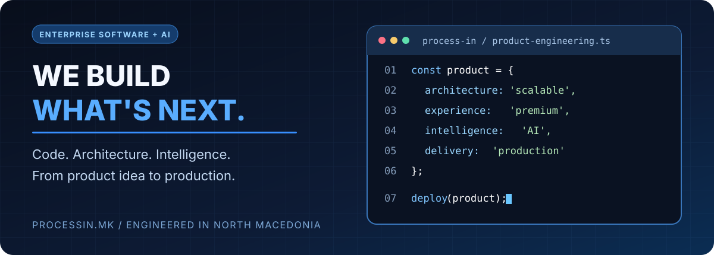

 

 

 

### We don't just build websites. We engineer products, platforms and intelligent systems.

**Custom Software · Enterprise Platforms · Multi-Tenant SaaS · Artificial Intelligence · Automation · Infrastructure**

---

## The engineering partner behind ambitious digital products

**PROCESS IN** is a software engineering and AI company based in North Macedonia. We design, build, integrate and operate digital products — from tailored enterprise applications to subscription SaaS platforms, AI-powered workflows and production infrastructure.

We combine **product strategy, software architecture, interface design, application development, integrations and operations** into one engineering workflow.

### 01 — ARCHITECT & BUILD 　→　 02 — AUTOMATE & INTEGRATE 　→　 03 — DEPLOY & EVOLVE

## What we engineer

<table>
<tr><td width="50%" valign="top">

### 🧠 AI & Intelligent Automation
LLM-powered applications, AI assistants, agentic workflows, document processing, intelligent classification, workflow orchestration and practical business automation.

### 🏗️ Custom Enterprise Software
Purpose-built operations platforms, industry-specific applications, portals, reporting, data flows and integrations aligned with real business processes.

### 🚀 SaaS & Product Engineering
Multi-tenant SaaS architecture, subscription billing, entitlements, onboarding, tenant isolation, white-label products and scalable product foundations.

### 🎨 Product Design & Experience
Premium responsive interfaces, design systems, dashboards, role-based workflows, multilingual products and accessibility-aware UX.

</td><td width="50%" valign="top">

### 🔗 APIs & Systems Integration
REST APIs, webhooks, payments, external services, legacy-system connectivity, secure data exchange and integration workflows.

### 📊 Data Platforms & Intelligence
Operational dashboards, analytics, data imports, monitoring, lead intelligence, business rules and decision-support systems.

### 🔐 Security & Reliability
Security-conscious architecture, access controls, data isolation, auditability, robust deployment practices and production diagnostics.

### ☁️ Infrastructure & DevOps
Linux hosting environments, deployment pipelines, performance troubleshooting, infrastructure integration and operational support — together with our [INHOST](https://inhost.mk) brand.

</td></tr>
</table>

---

## Technology ecosystem

## Product catalogue

**[Browse by category — English](docs/portfolio.en.md) · [Македонски](docs/portfolio.mk.md)**

## Selected products & platforms

Our portfolio spans vertical SaaS, developer tools, automation, AI, ticketing, infrastructure and business software.

| Platform | Focus |
|---|---|
| **[EVENTO](https://evento.mk)** | Ticketing, organizers, admissions and event operations |
| **[DentalDesk](https://dentaldesk.mk)** | Dental practice software and patient workflows |
| **[VetDesk](https://vetdesk.mk)** | Veterinary clinic management |
| **[MailBoost](https://github.com/stambolce/mailboost-email-platform)** | Internal business email outreach and campaigns |
| **[GoPlay](https://github.com/stambolce/goplay-sports-marketplace)** | Sports marketplace and service discovery |
| **[TeamDesk](https://github.com/stambolce/teamdesk-sports-performance)** | Sports training, coaching and athlete performance |
| **[Appify](https://github.com/stambolce/appify-mobile-app-builder)** | Website-to-mobile-app platform for businesses |
| **[AssetDesk](https://assetdesk.mk)** | IT asset lifecycle, inventory and QR workflows |
| **[EstateSpace](https://github.com/stambolce/estatespace-real-estate-saas)** | White-label real estate website SaaS |
| **[Coder](https://coder.mk)** | AI-powered no-code building |
| **[CodeHub](https://codehub.mk)** | Developer resources and marketplace |
| **[Validate](https://validate.mk)** | Surveys, feedback and decision validation |
| **[Toolkit](https://toolkit.mk)** | Online productivity utilities |
| **[INHOST](https://inhost.mk)** | Hosting, domains, cybersecurity and Linux infrastructure |

### Explore the full portfolio

Domain statuses in the public directory are owner-reported; they are not independent uptime checks or assertions that all planned features are implemented.

---

## How we deliver

**Discover** business needs → **Architect** secure systems → **Design** modern experiences → **Engineer** reliable software → **Integrate** services and data → **Deploy** production systems → **Improve** with continuous iteration.

Our approach favors maintainable architecture, clear product ownership, pragmatic AI use, secure integrations and long-term operability.

## Official company & brand links

- **PROCESS IN:** https://processin.mk
- **INHOST:** https://inhost.mk
- **GitHub founder profile:** https://github.com/stambolce
- **Services:** [English](docs/services.en.md) · [Македонски](docs/services.mk.md)
- **FAQs:** [English](docs/faq.en.md) · [Македонски](docs/faq.mk.md)
- **Contact:** contact@processin.mk

### LET'S ENGINEER YOUR NEXT PRODUCT.

**Built with purpose. Engineered for scale.**

---

Official public information about PROCESS IN. Proprietary source code, production credentials and customer data are not published here. No open-source license is granted for proprietary products.
