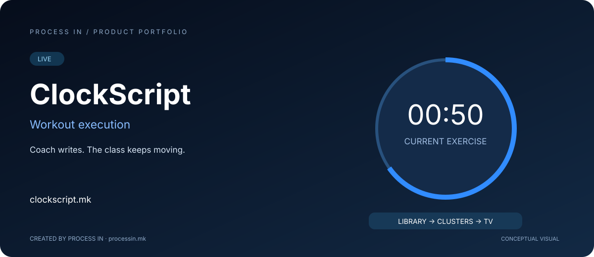

# ClockScript

**Тренерот подготвува. Часот продолжува.**

[English](README.md) · [Македонски](README.mk.md)

**LIVE** · Потврдено од сопственикот

## Што претставува

ClockScript е платформа за изведба на тренинзи за групни студија, тренери и домашни спортисти. Поврзува библиотека на вежби, блокови за тренинг, составување тренинзи, преглед на тајмер и приказ на ТВ.

## Како работи

| Чекор | Постапка |
|---|---|
| 1 | Создај и означи вежби |
| 2 | Подготви блокови со време или повторувања |
| 3 | Состави тренинг и прегледај секвенца |
| 4 | Стартувај ја сесијата на ТВ |

## Главни можности

| Област | Можности |
|---|---|
| **Библиотека** | Вежби со слики, GIF или видео. |
| **Блокови** | Комбинирање време, повторувања и одмор. |
| **Тренинзи** | Распоредување блокови и кругови. |
| **Преглед на тајмер** | Проверка на секвенцата пред почеток. |
| **ТВ приказ** | Одбројување, тековна и следна вежба. |
| **Јавно демо** | Разгледување пример на приказот. |

## Кому му е наменет

Студија за групен фитнес, тренери и домашни спортисти што бараат структурирана изведба.

## Практично сценарио

Тренер подготвува блокови пред часот, го проверува времетраењето и го пушта тренингот на заеднички екран за групата да ја следи секвенцата.

## Искуство со производот

Визуелизацијата е концептуална, а не слика од апликацијата. Актуелниот интерфејс, опциите и условите се достапни на официјалната веб-страница.

## Информации за производот

| Податок | Вредност |
|---|---|
| Домен | [clockscript.mk](https://clockscript.mk/) |
| Категорија | Изведба на тренинзи |
| Статус | LIVE |
| Развој | [PROCESS IN](https://processin.mk) |
| Контакт за портфолио | [contact@processin.mk](mailto:contact@processin.mk) |

Извор: [Официјална веб-страница](https://clockscript.mk/).

### [Посети ClockScript](https://clockscript.mk/)

[PROCESS IN — Your Enterprise Software & AI Partner](https://processin.mk)

---

Јавна презентација на производ. Без приватен изворен код, кориснички податоци или продукциски тајни. Не доделува open-source лиценца за производот.
