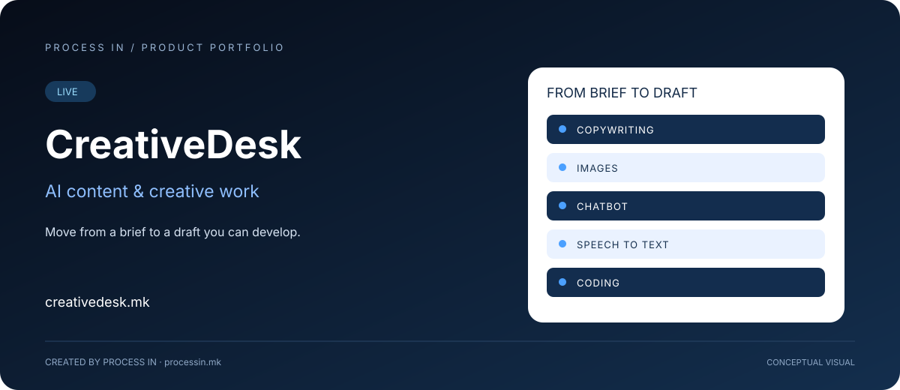

# CreativeDesk

### Од јасен бриф до нацрт што можеш да го развиваш.

**AI содржина и креативна работа**

[English](README.md) · [Македонски](README.mk.md)

**LIVE**

---

## Проблемот и решението

Креативната работа поврзува текстови, визуелни идеи, разговори, говорен материјал и код. На мал тим може да му требаат повеќе видови излез за иста иницијатива, поврзани со јасен бриф.

CreativeDesk е PROCESS IN бренд за создавање AI содржина, поврзан со Magical / MagicAI. Документираната корисничка понуда вклучува пишување текстови, слики, чет-бот, претворање говор во текст и кодирање. Корисниците пристапуваат кон различните задачи преку работа со AI.

## Кому му помага

| Корисник | Практична примена |
|---|---|
| **Маркетинг и содржински тимови** | Подготовка на текстуални и визуелни материјали според деловен бриф. |
| **Креатори и професионалци** | Развој на идеи во повеќе формати. |
| **Програмери** | Разгледување AI помош за задачи со код. |

## Што опфаќа производот

### Пишување текстови

Подготовка на текстуални нацрти според публика, тема и намена.

### Слики

Можност за AI визуелна и креативна работа.

### Чет-бот

Разговор при обработка на прашање или развој на нацрт.

### Говор во текст

Претворање говорен материјал во текст за преглед и уредување.

### Кодирање

AI помош при работа со код.

## Практичен тек на користење

| Чекор | Постапка |
|---|---|
| 01 | Дефинирај публика, излез и намена |
| 02 | Избери текст, слика, разговор, транскрипција или код |
| 03 | Достави бриф или изворен материјал |
| 04 | Прегледај и доработи пред употреба |

## Конкретни ситуации

### Нацрт за кампања

Маркетер тргнува од публика и порака, подготвува текст и разгледува визуелна насока преку можноста за слики.

### Работа од говорни белешки

Професионалец го претвора говорниот материјал во текст што потоа го прегледува, организира и уредува.

### Задача со код

Програмер користи AI помош, а резултатот го проверува според вистинските барања на проектот.

## Зошто да го разгледаш решението

Поврзувачкиот елемент е брифот: публиката, намената и контекстот треба да останат доследни низ форматите. CreativeDesk ги обезбедува наведените AI области, а корисникот ја задава насоката и го проверува резултатот. Платформата е применлива кога идејата треба да стане конкретен нацрт за понатамошна работа.

## Еден производ, поврзани брендови

CreativeDesk е актуелниот бренд поврзан со Magical / MagicAI. Оваа презентација ги обединува информациите за истиот производ; не се создава посебен репозиториум за Magical.

## Официјални информации

| Податок | Вредност |
|---|---|
| Производ | CreativeDesk |
| Официјален домен | [creativedesk.mk](https://creativedesk.mk/) |
| Статус | LIVE |
| Развој | [PROCESS IN](https://processin.mk) |
| Категорија | AI содржина и креативна работа |
| Портфолио | [PROCESS IN](https://github.com/stambolce/process-in) |
| Деловен контакт | [contact@processin.mk](mailto:contact@processin.mk) |

Опфатот е заснован на потврдените производни информации на PROCESS IN. HERO е концептуална визуелизација, а не слика од апликацијата.

### [Разгледај CreativeDesk →](https://creativedesk.mk/)

---

Јавна презентација на производ. Без приватен изворен код, кориснички податоци или пристапни тајни.

This platform is a digital product of <a href="https://processin.mk" target="_blank">PROCESS IN</a> · Your Enterprise Software & AI Partner ·  
Hosted on Enterprise Infrastructure by <a href="https://inhost.mk" target="_blank">INHOST</a> ·
