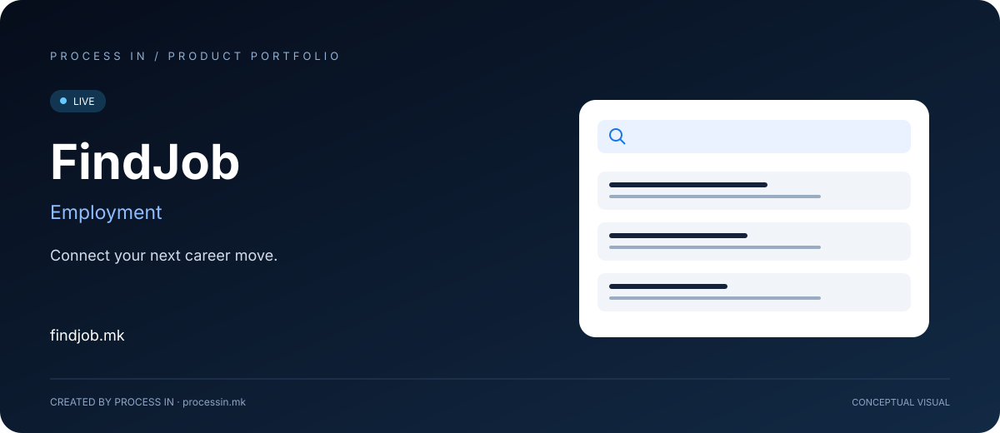

# FindJob

**Connect your next career move.**

[English](README.md) · [Македонски](README.mk.md)

**LIVE**

## Make the next hiring decision easier to understand.

A candidate needs more than a job title: the role, location, type of employment and employer must fit their situation. A company needs a clear way to present the position and give applicants enough context to decide whether to apply.

FindJob brings vacancies, company profiles and candidate-facing application sections into one local employment portal. It connects the discovery of a role with the information needed to prepare an application. For employers, the practical starting point is a well-defined vacancy supported by a company profile.

## How to get started

| Step | Action |
|---|---|
| 01 | Browse vacancies or companies |
| 02 | Apply relevant search filters |
| 03 | Review the position and employer |
| 04 | Sign in and follow the application instructions |

## Core capabilities

| Area | What it offers |
|---|---|
| **Job search** | Search by keyword and location. |
| **Filters** | Narrow listings by category, employment type and salary. |
| **Employer directory** | Explore company profiles and industries. |
| **Candidate account** | Access profile and saved-listing sections. |
| **Applications** | The application form includes a CV and cover letter. |
| **Employer publishing** | Company-facing navigation includes vacancy publishing and applications. |

## Who it helps—and what they need

| Audience | Practical use |
|---|---|
| **Job seekers** | Explore relevant roles, compare employment types and prepare a CV and cover letter for the position. |
| **Employers** | Present the business and publish a specific requirement rather than relying on an informal call for candidates. |
| **Recruitment teams** | Use the employer and application sections as the product's entry points into recruitment work. |

## Real situations to use it

### Changing careers

Start with a field and location, review the employer, then adapt the application to the actual role.

### Hiring for a specific position

Describe duties and qualifications clearly, present the company and direct applicants to the vacancy.

## Why consider this solution

The value is in connecting the vacancy with its context. Candidates can research a company alongside a role; employers can make the requirement more concrete. Search filters help reduce irrelevant exploration before either side invests time in an application.

## Product information

| Detail | Value |
|---|---|
| Website | [findjob.mk](https://findjob.mk/) |
| Category | Employment |
| Status | LIVE |
| Developer | [PROCESS IN](https://processin.mk) |
| Portfolio contact | [contact@processin.mk](mailto:contact@processin.mk) |

Presentation sources: [1](https://findjob.mk/) · [2](https://findjob.mk/jobs) · [3](https://findjob.mk/employers) · [4](https://findjob.mk/faq).

### [Visit FindJob](https://findjob.mk/)

[PROCESS IN — Your Enterprise Software & AI Partner](https://processin.mk)

---

Public product presentation. No proprietary application code or customer data.

This platform is a digital product of <a href="https://processin.mk" target="_blank">PROCESS IN</a> · Your Enterprise Software & AI Partner ·  
Hosted on Enterprise Infrastructure by <a href="https://inhost.mk" target="_blank">INHOST</a> ·
