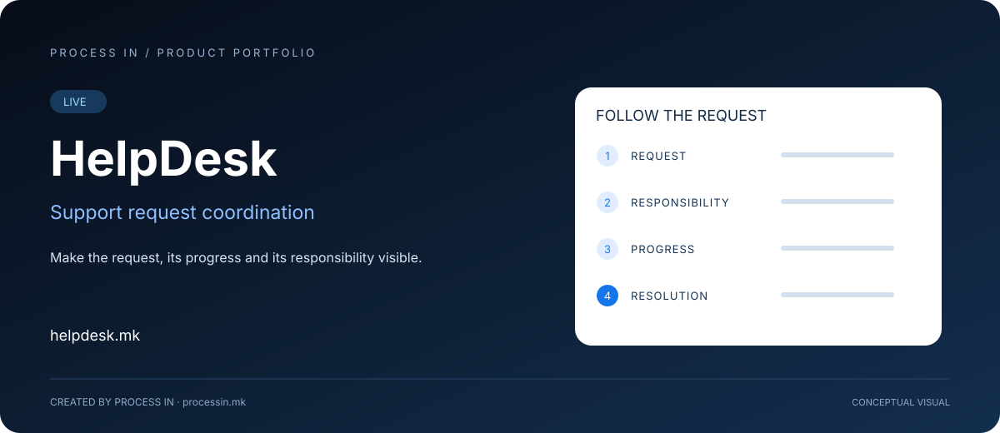

# HelpDesk

### Make the request, its progress and its responsibility visible.

**Support request coordination**

[English](README.md) · [Македонски](README.mk.md)

**LIVE**

---

## The problem and the solution

Support work becomes difficult to follow when a request is discussed in a Viber conversation, another update arrives through WhatsApp and a decision stays in email. The team needs a clear understanding of what is requested, who is responsible and how far the work has progressed.

HelpDesk is the PROCESS IN support platform addressing that coordination problem. Its confirmed product purpose centers on request status, progress, responsibility and resolution. The starting point is the support request as work that needs to be followed through.

## Who it helps

| Audience | Practical use |
|---|---|
| **Service and support teams** | Teams that need to follow requests from an initial question to a resolution. |
| **People coordinating work** | People who need to know what remains open and who is responsible. |
| **Organizations with scattered communication** | Organizations seeking a more explicit view of support progress across informal conversations. |

## What the product brings together

### Request status

Keep the current state of the support work explicit.

### Progress

Follow how the work advances toward resolution.

### Responsibility

Make the responsible person or role identifiable.

### Resolution

Connect the request with the outcome of the support work.

## A practical approach to using the platform

| Step | Action |
|---|---|
| 01 | Clarify the support request and its expected outcome |
| 02 | Identify responsibility for the next action |
| 03 | Keep the status and progress current |
| 04 | Record or review the resolution when the work is complete |

## Practical scenarios

### Following an unresolved issue

A coordinator checks the request's status and responsible person before deciding the next action.

### Keeping a handoff understandable

The team uses the request's progress and resolution context to understand what has been handled and what remains.

## Why consider this solution

The practical benefit is accountability around the request. A visible status explains where the work stands; responsibility explains who should take it forward; progress and resolution explain what happened. References to Viber, WhatsApp and email describe the fragmented communication problem, not an assertion that HelpDesk directly integrates with those services.

## 🇲🇰 HelpDesk — Македонски

HelpDesk е PROCESS IN платформа што го адресира овој координациски проблем. Потврдената намена ги опфаќа статусот на барањата, напредокот, одговорноста и разрешувањето. Почетната точка е барањето како работа што треба да се проследи до завршување.

[**Целосна македонска презентација →**](README.mk.md)

## Product information

| Detail | Value |
|---|---|
| Product | HelpDesk |
| Official domain | [helpdesk.mk](https://helpdesk.mk/) |
| Status | LIVE |
| Developer | [PROCESS IN](https://processin.mk) |
| Category | Support request coordination |
| Portfolio | [PROCESS IN](https://github.com/stambolce/process-in) |
| Business contact | [contact@processin.mk](mailto:contact@processin.mk) |

The scope is based on confirmed PROCESS IN product information. The hero is a conceptual illustration, not an application screenshot.

### [Explore HelpDesk →](https://helpdesk.mk/)

---

Public product presentation. No proprietary application code, customer data or access secrets.

This platform is a digital product of <a href="https://processin.mk" target="_blank">PROCESS IN</a> · Your Enterprise Software & AI Partner ·  
Hosted on Enterprise Infrastructure by <a href="https://inhost.mk" target="_blank">INHOST</a> ·
