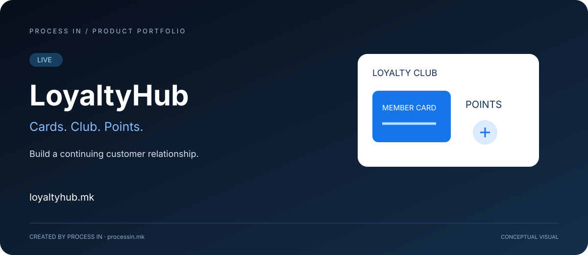

# LoyaltyHub

**Give customers a reason to stay connected.**

[English](README.md) · [Македонски](README.mk.md)

**LIVE**

## The problem and the solution

LoyaltyHub is a PROCESS IN platform for loyalty cards, membership clubs and points. It gives a business a recognizable loyalty programme around which to build an ongoing relationship with its customers.

A purchase is one interaction. A club gives the relationship a continuing context: a customer belongs to a programme and points form part of that experience. LoyaltyHub is intended for businesses that want to organize this relationship as a defined service rather than communicate each offer in isolation.

## How to get started

A recommended approach to evaluating and introducing the product:

| Step | Action |
|---|---|
| 01 | Review the loyalty-card, club and points offering on the official website. |
| 02 | Define the customer group and the purpose of your loyalty programme. |
| 03 | Explain participation and programme terms clearly to customers. |
| 04 | Use the available programme experience to maintain the customer relationship. |

## Product scope

| Area | Purpose |
|---|---|
| **Loyalty cards** | A recognizable card-based identity for participation in a loyalty programme. |
| **Membership club** | A club context connecting participating customers with the business's loyalty offering. |
| **Points** | A points component within the loyalty programme. The business's actual programme terms determine how participation works. |

## Who it is for

Business owners and teams responsible for customer relationships, repeat visits and loyalty programmes. Customers benefit from a clearer understanding of the programme they are joining.

## Practical scenario

A business wants regular customers to recognize its loyalty offering. A named club, a loyalty card and a points component give that offering a consistent identity. Before introducing it, the team should establish the programme terms and explain them in language customers understand.

## Why consider it

The practical value is structure: the card identifies the programme, the club gives participation a continuing context, and points provide a programme mechanism. This makes the loyalty proposition easier to communicate across customer interactions. Success still depends on an appropriate offering and clear terms; this presentation makes no promises about retention or sales results.

## What to discuss with the team

When evaluating LoyaltyHub, discuss the intended programme and its rules with PROCESS IN. Card format, earning and redemption conditions, reward eligibility and any connection to existing business systems should be confirmed for your use case. This presentation does not specify those commercial or technical arrangements.

## Product experience

The hero illustrates the product's purpose conceptually. Explore the current interface and offering through the official product.

## Product information

| Detail | Value |
|---|---|
| Website | [loyaltyhub.mk](https://loyaltyhub.mk) |
| Category | Loyalty cards, clubs & points |
| Status | LIVE |
| Developer | [PROCESS IN](https://processin.mk) |
| Portfolio | [PROCESS IN GitHub](https://github.com/stambolce/process-in) |

### [Visit LoyaltyHub](https://loyaltyhub.mk)

---

Public product presentation. No proprietary application code or customer data.

This platform is a digital product of <a href="https://processin.mk" target="_blank" >PROCESS IN </a>· Your Enterprise Software & AI Partner ·  Hosted on Enterprise Infrastructure by <a href="https://inhost.mk" target="_blank">INHOST</a>·
