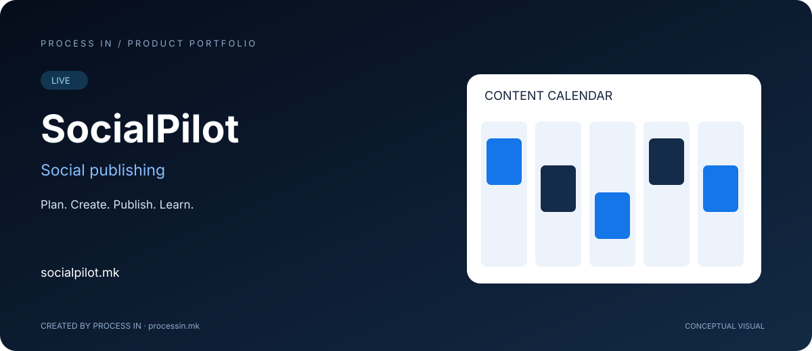

# SocialPilot

**Plan. Create. Publish. Learn.**

[English](README.md) · [Македонски](README.mk.md)

**LIVE** · Owner-confirmed

## The product

SocialPilot organizes social content from the first draft to publishing and analytics. The official site presents a workspace for connected channels, media, AI-assisted content and team coordination. Available channels and publishing options depend on the plan and provider settings.

## How it works

| Step | Action |
|---|---|
| 1 | Connect relevant profiles |
| 2 | Develop the campaign idea |
| 3 | Review and schedule each post |
| 4 | Publish and learn from analytics |

## Core capabilities

| Area | Capabilities |
|---|---|
| **Content calendar** | Keep drafts and scheduled posts visible. |
| **AI content** | Develop text, hashtags, images and variations. |
| **Publishing** | Adapt and publish through connected profiles. |
| **Analytics** | Review channel results in context. |
| **Team workspaces** | Coordinate planning and review. |
| **Media library** | Organize images and video for posts. |

## Who it is for

Agencies, brands and creators managing recurring social content.

## Practical scenario

An agency can plan a campaign in a shared calendar, adapt posts to connected channels and keep the associated media together.

## Product experience

The illustration is conceptual, not an application screenshot. The official website provides the current interface, options and terms.

## Product information

| Detail | Value |
|---|---|
| Domain | [socialpilot.mk](https://socialpilot.mk/) |
| Category | Social publishing |
| Status | LIVE |
| Developer | [PROCESS IN](https://processin.mk) |
| Portfolio contact | [contact@processin.mk](mailto:contact@processin.mk) |

Source: [Official website](https://socialpilot.mk/).

### [Visit SocialPilot](https://socialpilot.mk/)

[PROCESS IN — Your Enterprise Software & AI Partner](https://processin.mk)

---

Public product presentation. No proprietary source code, customer data or production secrets. No open-source license to the product is granted.
